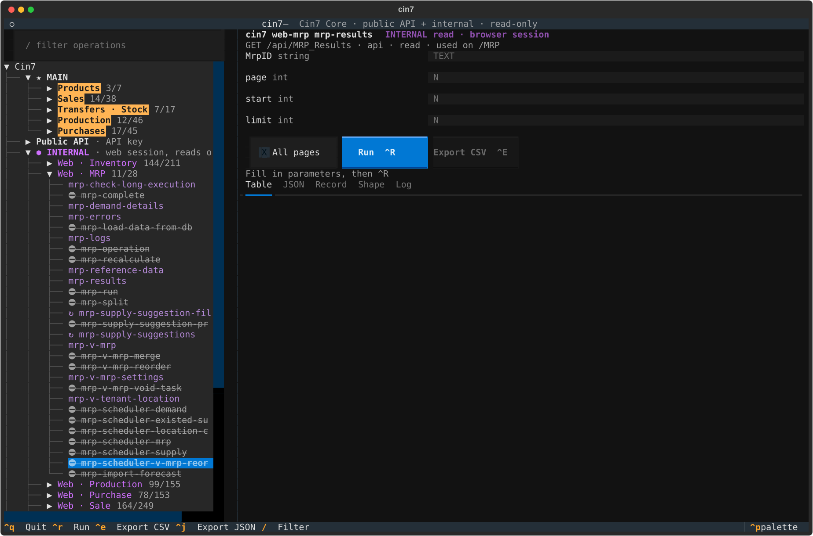

# cin7-core-cli

A command line for the **Cin7 Core (DEAR Inventory) public API v2**. Every one of the API's 295 operations is a
command, generated from the API map in
[`fightmilk808/cin7-core-rebuild`](https://github.com/fightmilk808/cin7-core-rebuild)
(`data/public-api-shapes.json` + `data/public-api.csv`).

It is **read-only by default**. GETs run. POST, PUT and DELETE need `--allow-write` and a person typing the
operation name at a real terminal (see [Safety model](#safety-model)).

```text
cin7 <group> <operation> [--query-flags] [-o json|table|csv] [--all-pages]
```

| | |
|---|---|
| Groups | 32 (`sale`, `product`, `purchase`, `production`, `stock`, `customer`, `supplier`, `webhooks`, `me`, `crm`, …) |
| Operations | 295 · 102 reads · 193 writes |
| Paged lists (`--all-pages`) | 47 |
| Runtime dependencies | none for the CLI (Python 3.10+ standard library); Textual for the optional TUI |

## Install

```bash
pipx install git+ssh://git@github.com/fightmilk808/cin7-core-cli.git
```

Or from a checkout:

```bash
git clone git@github.com:fightmilk808/cin7-core-cli.git && cd cin7-core-cli && pip install -e '.[dev]'
```

## TUI

```bash
pipx install 'cin7-core-cli[tui] @ git+ssh://git@github.com/fightmilk808/cin7-core-cli.git'
cin7 tui
```



A [Textual](https://textual.textualize.io) terminal UI over the same spec, client, pacing and auth as the CLI:

- **Left:** every group and operation. `/` filters by name, path or resource. Writes show in orange with ✎.
- **Form:** one typed field per query parameter, with required ones starred and checked before anything is sent.
  Enter or `^R` runs it; **All pages** walks a paged list.
- **Results:** Table (Enter on a row opens it in Record), raw JSON, the Blueprint Shape, and a Log of calls.
  `^E` / `^J` save the result as CSV or JSON in the current folder.
- Sale rows lead with `CustomerReference`, then the `SO-` number (the CLI's table and CSV do the same).

**The TUI is read-only, full stop.** Write operations are listed so their request shapes can be read, but there is
no way to send one from it; the Run button is disabled and the run path refuses them too.

## Auth

Cin7 wants two headers on every call, `api-auth-accountid` and `api-auth-applicationkey`. The CLI reads them from
environment variables. Each can be the value itself or a **1Password reference**, resolved with `op read` at call time:

```bash
export CIN7_ACCOUNT_ID='op://<vault>/<item>/account-id'
export CIN7_APP_KEY='op://<vault>/<item>/application-key'
```

The values are never written to disk, never printed, and are masked (`***`) if Cin7 ever echoes them back in an
error. `.env.example` lists every variable; keep real values out of the repo.

| Variable | Default | |
|---|---|---|
| `CIN7_ACCOUNT_ID`, `CIN7_APP_KEY` | none | value or `op://` reference |
| `CIN7_RATE_PER_MIN` | `40` | calls per minute, capped at 60 |
| `CIN7_CLI_READ_ONLY` | unset | set to `1` to switch writes off outright |
| `CIN7_BASE_URL` | `https://inventory.dearsystems.com/ExternalApi/v2` | point at a mock server for testing |
| `CIN7_CLI_STATE_DIR` | `~/.cache/cin7-cli` | where the shared pacing file lives |

## Examples

```bash
cin7 me get                                          # company, base currency, timezone, lock date
cin7 sale list --search '#25147' -o table --fields CustomerReference,OrderNumber,Status,OrderDate
cin7 sale get --id 3f2c…-…                            # full sale with Fulfilments[] Pick/Pack/Ship
cin7 sale list --updated-since 2026-10-01 --all-pages -o csv > sales.csv
cin7 product list --modified-since 2026-10-01 --all-pages
cin7 product get --sku LT-1234 --include-bom true --include-suppliers true
cin7 production order-list --status Released --all-pages -o table
cin7 stock transfer-list --all-pages --max-pages 5
cin7 webhooks list -o table
cin7 raw GET /ref/productavailability -q Sku=LT-1234   # any path, same rules
```

Finding things:

```bash
cin7 --help                     # groups
cin7 sale --help                # operations in a group, each tagged [read] or [WRITE]
cin7 sale list --help           # typed flags for every query parameter
cin7 ops fulfilment             # search every operation (command, method, path, paged)
cin7 ops --reads -o csv         # just the GETs
cin7 describe sale get          # params, request shape and response shape from the Blueprint
cin7 webhook-events Sale/Created
cin7 tui                        # browse and run reads interactively
```

### How commands are named

- **Group** = the API Blueprint group, kebab-cased: `Reference Books` → `reference-books`.
- **Operation** = resource (minus the group's own words) + verb. Verbs: GET → `get`, or `list` for a collection;
  POST → `create`; PUT → `update`; DELETE → `delete`; named actions keep their name (`order-authorise`,
  `run-complete`). So `Sale Fulfilment Pick` POST is `cin7 sale fulfilment-pick-create`.
- Lists that also return one record by `ID` (`/product`, `/customer`, `/supplier`, …) answer to `get` as well.
- **Flags** = query parameters, kebab-cased and typed: `ModifiedSince` → `--modified-since`, `IncludeBOM` →
  `--include-bom true|false`, `Page` → `--page N`. GUID flags are checked; required ones are enforced. Anything the
  map missed can go in with `-q Key=Value`.

### Output

`-o json` (default) prints Cin7's JSON. `-o table` and `-o csv` print the rows of a list (or the one record of a
detail call); nested arrays show as a count (`[3]`). `--fields A,B,C` picks and orders columns.

### Paging

`--all-pages` walks `Page=1,2,…` at `Limit` (default 100) until the list's `Total` is reached or a page comes back
short, and prints one merged envelope `{Total, Pages, <ListKey>: [...]}`. `--max-pages N` caps it. Progress goes to
stderr. Cin7 lists have no stable sort, so dedupe by ID if records may change during the walk.

## Rate limiting

Cin7 allows 60 calls a minute per API application. If your key is shared with other integrations, every call this
tool makes is one they can't. So:

- Calls are spaced at **40 a minute by default** (`--rate`, `CIN7_RATE_PER_MIN`), never more than 60.
- The spacing is **shared by every `cin7` process on the machine** through one locked file, so a shell loop of
  single calls is paced the same as one `--all-pages` run.
- A **429** waits for `Retry-After` (or 5 s, 15 s, 30 s, 60 s), pushes the shared clock back for everyone, and
  retries up to 4 times. A 5xx on a GET is retried the same way; a write is never retried.

## Errors

| Cin7 answer | What you see | Exit |
|---|---|---|
| 302 to `/Error/NotFound` | `HTTP 302: … wrong path or casing` (redirects are not followed) | 1 |
| 400 with `[{"Exception": …}]` | the exception text, e.g. `Sale not found` | 1 |
| 403 | `forbidden: the account id or application key is wrong or revoked` | 1 |
| 429 after retries | `rate limited and retries exhausted` | 1 |
| Write refused by the gate | why, and what would be needed | 2 |
| Bad flag or value | argparse usage | 2 |
| Missing credentials or `op read` failed | which variable | 3 |

## Safety model

Reads are free. A write (POST, PUT, DELETE, from a generated command or `cin7 raw`) is sent only when **all** of
these hold:

1. `CIN7_CLI_READ_ONLY` is not set. Set it on shared machines and agent hosts.
2. The command carries `--allow-write`.
3. The CLI prints the full request (method, URL, body; never the headers), and a person at the **controlling
   terminal** types the operation name back exactly, e.g. `sale create`. The answer is read from `/dev/tty`, not
   stdin, so it can't be piped, scripted or answered by an agent without a terminal.

`--dry-run` prints any request, read or write, without calling Cin7.

> **Shared or production accounts:** set `CIN7_CLI_READ_ONLY=1` wherever the key lives, so the write path is off
> outright.

## Development

```bash
pip install -e '.[dev]'
pytest -q --cov=cin7_cli                 # mock HTTP server only; no live calls
python scripts/build_spec.py ../cin7-core-rebuild   # regenerate src/cin7_cli/spec.json from the API map
```

The tests start a local HTTP server that plays Cin7 (paging, 429 with `Retry-After`, 302 on a wrong path, 400
missing record, 403) and point `CIN7_BASE_URL` at it; every other test gets a closed local port, so nothing can
reach the live API. Writes are exercised only against that mock. A test also checks that the committed `spec.json`
matches what `build_spec.py` produces when the rebuild repo is checked out next to this one.

| Path | What |
|---|---|
| [`scripts/build_spec.py`](scripts/build_spec.py) | API map → `spec.json` (names, typed flags, required marks, list keys) |
| [`src/cin7_cli/cli.py`](src/cin7_cli/cli.py) | argparse commands built from the spec |
| [`src/cin7_cli/client.py`](src/cin7_cli/client.py) | HTTP, no-redirect, retries, error text |
| [`src/cin7_cli/safety.py`](src/cin7_cli/safety.py) | the write gate |
| [`src/cin7_cli/ratelimit.py`](src/cin7_cli/ratelimit.py) | cross-process pacing |
| [`src/cin7_cli/paging.py`](src/cin7_cli/paging.py) | `--all-pages` |
| [`src/cin7_cli/output.py`](src/cin7_cli/output.py) | json / table / csv |
| [`src/cin7_cli/tui.py`](src/cin7_cli/tui.py) | `cin7 tui` (Textual, read-only) |

### Known gaps in the source map

- Two responses were only outlined by the Blueprint parser; their list keys are set by hand in `build_spec.py`
  (`/product` → `Products`, `/production/workcenters` → `Workcenters`).
- In the Blueprint, CRM `Task Category` and `Workflow` GETs both point at `/crm/task`; the commands keep that path
  as published.
- Query parameters that appear only in a path template are typed as text.
- v1-only resources (`/ExternalApi/<Resource>`) are not in the map; reach them with `CIN7_BASE_URL` plus `cin7 raw`.
