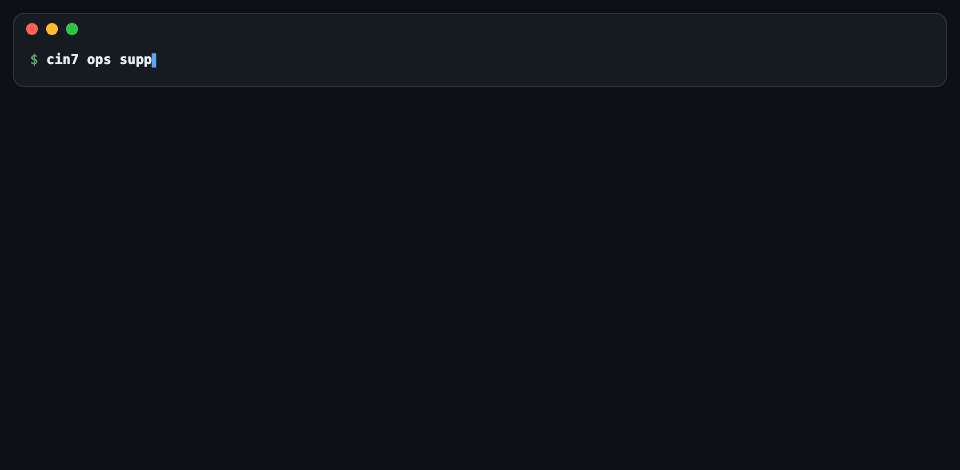
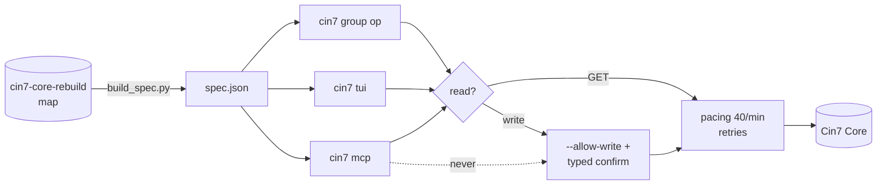
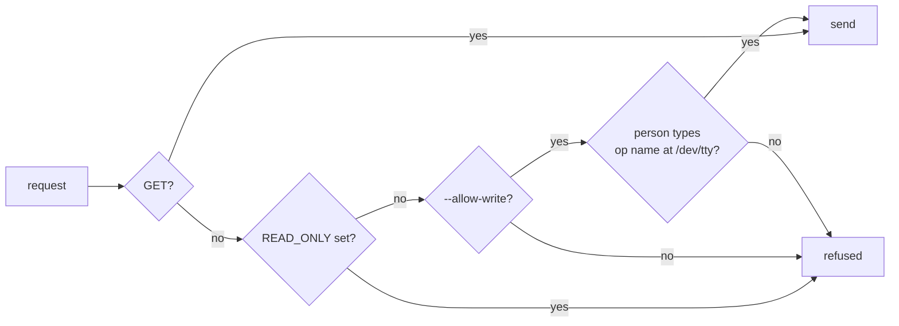

# cin7-core-cli

[](pyproject.toml)
[](pyproject.toml)
[](#safety)
[](#mcp-server)
[](tests/)

**Every Cin7 Core public API v2 operation as a command, a terminal UI, and an MCP server.** Generated from the [cin7-core-rebuild](https://github.com/fightmilk808/cin7-core-rebuild) map.



| 🌍 Public operations | 📖 Reads · ✍️ writes | 🔌 Internal endpoints | 📄 Paged lists | 📦 Groups |
|:-:|:-:|:-:|:-:|:-:|
| **295** | **102** · 193 | **2,177** mapped · 1,365 sendable reads | **47** | **32** |

## Three ways in



| | Command | Best for |
|---|---|---|
| ⌨️ CLI | `cin7 sale list -o table` | Scripts, CSV exports |
| 🖥️ TUI | `cin7 tui` | Browsing, filters, sorting |
| 🤖 MCP | `cin7 mcp` | Agents (Claude Code, any MCP client) |

## Install

```bash
pipx install 'cin7-core-cli[tui] @ git+ssh://git@github.com/fightmilk808/cin7-core-cli.git'
```

```bash
cin7 auth setup --account-ref 'op://<vault>/<item>/username' --key-ref 'op://<vault>/<item>/password'
```

```bash
cin7 auth test
```

| Variable | Default | |
|---|---|---|
| `CIN7_ACCOUNT_ID` · `CIN7_APP_KEY` | | value or `op://` ref (one 1Password approval per run) |
| `CIN7_CLI_READ_ONLY` | on after `auth setup` | `1` = writes off outright |
| `CIN7_RATE_PER_MIN` | `40` | capped at 60 |

## Examples

| Do | Command |
|---|---|
| Find an operation | `cin7 ops supplier` |
| See its shape | `cin7 describe sale get` |
| Look up by text, not id | `cin7 sale get --id '#10001'` |
| Export all to CSV | `cin7 sale list --updated-since 2026-10-01 --all-pages -o csv > sales.csv` |
| Pick columns | `cin7 sale list -o table --fields CustomerReference,Status,OrderDate` |
| Any path | `cin7 raw GET /ref/productavailability -q Sku=ABC-1234` |
| Preview a request | add `--dry-run` |

## TUI


| Key | Does | Key | Does |
|:-:|---|:-:|---|
| `/` | filter operations | `s` | sort column |
| `f` | show filters | `ctrl+f` | search results |
| `1`–`4` | quick views (open MOs, waiting on stock, latest MRP, to ship) | `o` · `u` | open · copy Cin7 link |
| `p` | pin operation | `ctrl+s` | save filters |
| `Space` · `P` | mark rows · print | `?` | every key |

More: [docs/GUIDE.md](docs/GUIDE.md#tui).

## MCP server

| Tool | Keys needed | Does |
|---|:-:|---|
| `search_operations` | – | Find endpoints by words |
| `describe_operation` | – | Params, shapes, read/write, calling pages |
| `page_operations` | – | What a web page (e.g. `/MRPList`) calls |
| `list_groups` | – | Groups with read/write counts |
| `auth_status` | – | Where keys come from (never values) |
| `read` | ✅ | One public GET, ≤ 200 rows |

```bash
claude mcp add cin7-core -e CIN7_ACCOUNT_ID=op://Vault/Cin7/username -e CIN7_APP_KEY=op://Vault/Cin7/credential -- cin7-mcp
```

🧠 Agent skill: [skills/cin7-core/SKILL.md](skills/cin7-core/SKILL.md) → copy to `~/.claude/skills/`.

## Safety



| Surface | Reads | Writes |
|---|:-:|:-:|
| Public API (CLI) | ✅ | gated (above) |
| Public API (TUI) | ✅ | ❌ never |
| MCP server | ✅ | ❌ never |
| Internal web endpoints | ✅ mapped reads only, your browser cookie | ❌ never |

## Errors

| Cin7 says | You see | Exit |
|---|---|:-:|
| 302 → `/Error/NotFound` | wrong path or casing | 1 |
| 400 `[{"Exception"}]` | the exception text | 1 |
| 403 | key wrong or revoked | 1 |
| 429 ×4 | retries exhausted (paced, `Retry-After` honoured) | 1 |
| write refused | why + what's needed | 2 |
| missing creds | which variable | 3 |

## More

| | |
|---|---|
| 📘 Full guide (TUI, printing, internal endpoints, naming, paging) | [docs/GUIDE.md](docs/GUIDE.md) |
| 🗺️ The map it's built from | [cin7-core-rebuild](https://github.com/fightmilk808/cin7-core-rebuild) |
| 🧩 Browser extension starter | [cin7-core-extension-example](https://github.com/fightmilk808/cin7-core-extension-example) |
| 🧪 Develop | `pip install -e '.[dev]' && pytest -q` (mock server only, never live) |
